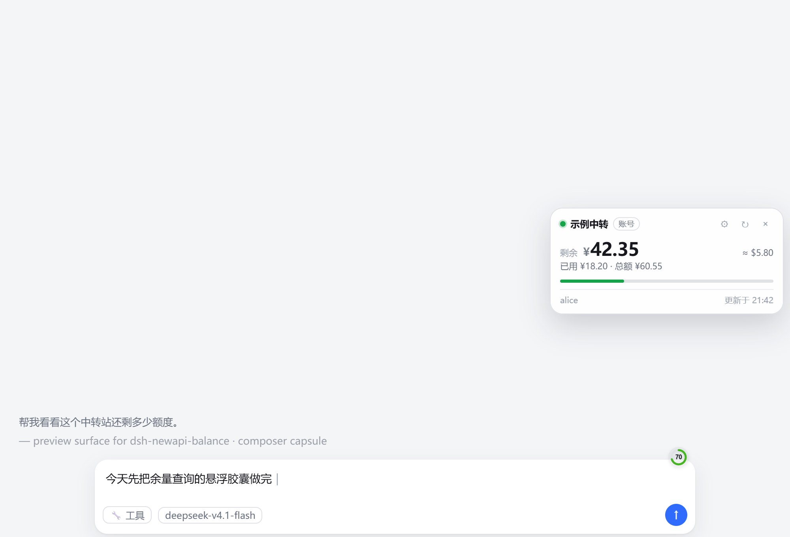
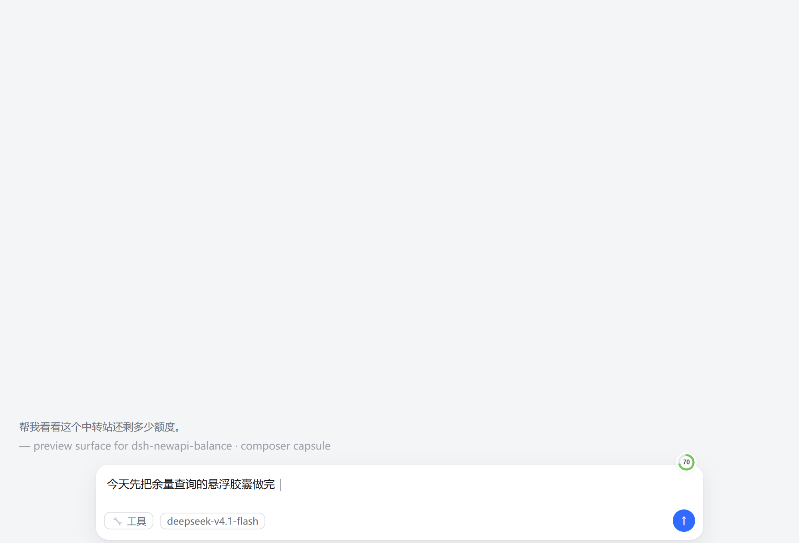
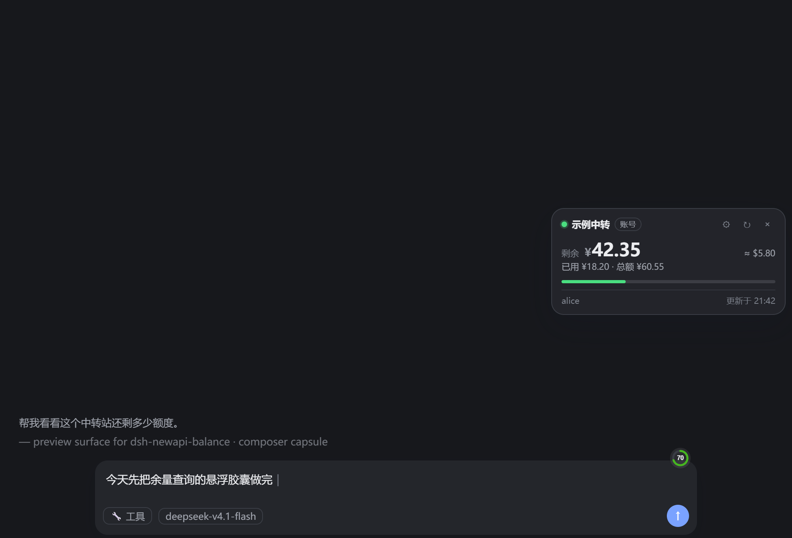

# dsh-newapi-balance

[](https://www.npmjs.com/package/dsh-newapi-balance)
[](LICENSE)

在 DeepSeek Harness 输入框右上角放一个安静的小圆点，点开是一枚悬浮胶囊，随时看中转站（New API / One API 系）还剩多少额度——对应 CC Switch 的「余量查询」。

```text
plugin_manager action=install_bundle target="dsh-newapi-balance"
```



| 收起：环形余量徽标 | 深色主题 |
| --- | --- |
|  |  |

## 长什么样

- **收起**：输入框卡片右上角一枚 26px 的环形小徽标，环里是**剩余额度占比**（例如 `90` 就是还剩 90%），环的颜色随余量从绿走到红：90% 以上是绿，快到一半转黄，跌破 15% 转红；额度不限的密钥是整个蓝环 + `∞`，读取失败是 `!`，还没配置站点是灰色 `…`。
- **展开**：点这枚徽标，徽标上方浮出一枚胶囊（不撑开布局、不遮挡输入），再次点击徽标、按 `Esc`、或点胶囊外面都会收起。
- **可拖动**：按住胶囊顶部标题栏就能拖到窗口任意位置，位置存在浏览器本地（`localStorage`），刷新后还在原处；双击标题栏回到输入框上方。

胶囊内容：

| 场景 | 主数字 | 说明 |
| --- | --- | --- |
| 有账号令牌、站点返回余额 | `剩余 ¥x` | 顶部小字为美元近似值，下方一条进度条显示已用比例 |
| 只有 `sk-` 密钥、站点支持用量查询 | `已用 ¥x` + 「额度不限」徽标 | 该密钥没有额度上限，站点不返回剩余；胶囊里给一个「填访问令牌看账户余额」的入口 |
| 余额为 0 | `剩余 ¥0.00` + 「已用尽」 | 环转红、占比 `0` |
| 站点限流（429） | 上一次的数字，底部标「限流中」 | 按站点给的 `Retry-After` 退避，恢复后自动更新 |
| 读不到 | 「读不到余量」+ 原因 | 底部给出站点域名与「重试」 |

右下角 `↻` 手动刷新；刷新间隔取自配置里的「间隔分钟」（默认 5），页面切到后台时暂停。第一次打开（还没配置站点）时，胶囊直接展开成配置表单。

## 配置：胶囊里的 ⚙

点圆点展开胶囊 → 右上角 `⚙` → 填表 → 保存，**立即生效、不用重启**（写到 `~/.dsh/newapi-balance.json`，host 侧每次查询都会重读）：

| 字段 | 填什么 |
| --- | --- |
| 站点地址 | 站点根地址，例如 `https://newapi.example.com`，**不要带 `/v1`** |
| 密钥（直接黏） | `sk-` 密钥本身，**直接粘贴在这里**，优先级高于下面的密钥名。右侧小眼睛可切换明文/掩码，打开表单时会带出已保存的值 |
| 密钥名 | `~/.dsh/.credentials.yaml` 里存放该站 `sk-` 密钥的名字，例如 `N_API_KEY`；填对了会显示「✓ 已找到这把密钥」 |
| 用户 ID（可选） | 站点「个人设置」里的数字 ID。只填令牌也能读余额（站点用令牌认人），少数站点会额外校验这个头，报 401 时再填 |
| 访问令牌（可选） | 站点「个人设置 → 安全设置」里生成。**填了才看得到账户剩余**（就是 CC Switch 里那两栏），单独填这一项就够。同样有小眼睛可以看已保存的值 |
| 间隔分钟 | 自动查询间隔，0 表示不自动；中转站限流严，建议 5 以上 |
| 显示货币 | **美元（不换算，默认）** 或 **人民币（按站点汇率换算）**。站点记账本身用美元，人民币是 `quota_per_unit` 与站点汇率换算出来的，不需要就别开 |

- 密钥和密钥名二选一：黏一把密钥进「密钥」，就不用再去 `~/.dsh/.credentials.yaml` 里配名字。
- 只填密钥：读到的是**这把密钥**的用量与额度上限；`unlimited_quota` 的密钥只能看已用。
- 再填令牌（用户 ID 可选）：切到**账户**视角，读账户余额与已用 —— 想看「还剩多少」就走这条。

表下面这些老办法仍然可用（值优先级：`~/.dsh/newapi-balance.json` > 界面/profile 覆盖块）：

### 在界面里填（设置 → 插件）

设置 → 插件 → 找到 `newapi-balance` → 填同样几个字段。保存后 harness 会把覆盖块写进这个 profile 的 `cordis.patch.yml`，重启应用生效。

密钥放在 `~/.dsh/.credentials.yaml`，一行即可：

```yaml
N_API_KEY: sk-xxxxxxxxxxxxxxxx
```

### 直接编辑 profile

不想点界面就手工追加到这个 profile 的 `cordis.patch.yml`（数组末尾，顶层条目）：

```yaml
- id: newapi-balance
  name: dsh-newapi-balance
  config:
    enabled: true
    baseUrl: https://newapi.example.com
    apiKeyEnv: N_API_KEY
    accessToken: ""
    userId: ""
    refreshMinutes: 5
    currency: usd
```

**别改插件包里那份 `cordis.patch.yml`**（`node_modules/dsh-newapi-balance/cordis.patch.yml`）：它只提供空默认值，重装插件时会被覆盖；自己的值写在 profile 里才留得住。

### 用本机 JSON（可选，优先级最高）

`~/.dsh/newapi-balance.json` 存在时，其中出现的字段会盖过界面/组合配置：

```json
{
  "baseUrl": "https://newapi.example.com",
  "apiKeyEnv": "N_API_KEY",
  "refreshMinutes": 5,
  "currency": "usd"
}
```

适合临时切站点或不想动组合配置；删掉这个文件就退回界面配置。这个文件是**每次查询时重读**的，改完不用重装、不用重启，下一次轮询（最多 1 分钟）就生效。

凭据永远只留在本机：host 侧通过 `~/.dsh/.credentials.yaml` 读取，不会进入对话，也不会写进日志。

## 给别人用

插件就是 `D:\testwork\dsh-newapi-balance` 这一个目录（没有构建步骤，`lib/` 即发布物），分发它有两种方式：

**A. 发目录（或 `dist/` 里的 `.tgz`）**

1. 把整个 `dsh-newapi-balance` 目录（或把它解压出来的路径）给对方，放在任意位置。
2. 对方在 DSH 里让 AI 装：`plugin_manager` → `install_bundle`，`target` 填那个目录的**绝对路径**（例如 `D:\plugins\dsh-newapi-balance`）。会写进对方 profile 的依赖与 `dsh.profile.bundles`。
3. **重启 DSH 应用**（host 半侧），再刷新窗口（client 半侧）。
4. 按上面「配置」填自己的站点。

> 已装过的同一目录再 `install_bundle` 会报 `already-installed`，升级时要么先 `remove_bundle`，要么指向新的 `.tgz`（后者可直接覆盖安装）。

**A.5 一条命令搞定配置**：装完后直接写 `~/.dsh/newapi-balance.json`（见上）写 `baseUrl` 和 `apiKeyEnv` 即可，host 侧每次查询都会重读这个文件，**不用重启**。

可以直接把下面这段发给对方的 AI：

```text
帮我安装本地插件：用 plugin_manager action=install_bundle，
target 填 D:\plugins\dsh-newapi-balance（已解压的绝对路径）。装完提醒我重启应用。
然后再帮我写 ~/.dsh/newapi-balance.json，内容是（把地址和密钥名换成我的）：
{"baseUrl":"https://newapi.example.com","apiKeyEnv":"N_API_KEY"}
```

**B. 发一个 `.tgz`**

```bash
cd dsh-newapi-balance
npm pack --pack-destination ../dist   # 产出 dist/dsh-newapi-balance-<版本>.tgz
```

对方拿到后两种用法都行：

- 直接当安装目标：`install_bundle` 的 `target` 填 `.tgz` 的绝对路径（已验证可直接覆盖安装/升级）。
- 解压（`tar -xzf dsh-newapi-balance-<版本>.tgz`）得到 `package/` 目录，再按 A 的方式用绝对路径安装。

想公开发布就 `npm publish`（要有自己的 npm 账号），之后 `install_bundle` 的 `target` 可以填包名。

装好之后对方看到的东西和你一模一样：输入框右上角一枚环形余量徽标，点开是胶囊。包里没有你的站点、没有你的令牌。

## 数据怎么来的

host 端（`lib/index.js`）挂了一个 localserver 路由 `GET /api/newapi-balance`，只接受本机回环请求：

- 账户模式：`GET /api/user/self`（`Authorization: Bearer <accessToken>`；填了用户 ID 时再加 `New-Api-User: <userId>`）
- 已保存的密钥/令牌：`GET /api/newapi-balance/reveal`，只给面板的小眼睛用，同样限制 loopback
- 密钥模式：`GET /api/usage/token/`（`Authorization: Bearer <sk-...>`）
- 金额换算用 `GET /api/status` 的 `quota_per_unit` 与价格；站点没给时退回 500000（New API 默认）

client 端（`lib/client.js`）只负责每 60 秒读一次这个路由并渲染，不直接碰站点。

## 安装 / 更新

- **从 npm（推荐）**：`plugin_manager` → `install_bundle`，`target` 填包名 `dsh-newapi-balance`（或带版本号 `dsh-newapi-balance@0.1.10`），会自动从 registry 拉取。已发布在 <https://www.npmjs.com/package/dsh-newapi-balance>。
- **首次安装（本地）**：`plugin_manager` → `install_bundle`，`target` 填包目录的绝对路径，或 `.tgz` 文件路径（两种都验证过）。
- **从 GitHub**：仓库在 <https://github.com/43456-awa/dsh-newapi-balance>，`git clone` 后按目录方式装，或直接下 Releases 里的 `.tgz`。
- **升级**：`install_bundle` 指向**新的 `.tgz`** 会直接覆盖安装；指向**同一个目录**会报 `already-installed`，需要先 `remove_bundle` 再装（想要"改代码立刻生效"就用目录装 + 重装）。
- **只改配置**：不用重装、不用重启，改 `~/.dsh/newapi-balance.json` 后等下一次轮询即可；改 profile 覆盖块或界面配置则重启应用后生效。

装好后刷新窗口（client bundle 在页面加载时载入）；host 侧代码变更由插件管理器热应用，个别情况下重载应用最稳。

## 开发

没有构建步骤，`lib/index.js` 与 `lib/client.js` 就是发布物。改完直接刷新窗口即可预览客户端效果；`D:\testwork\_tl\preview` 里有一份脱离 harness 的预览页（模拟输入框卡片 + 各种状态数据），配合无头 Chrome 截图核对样式。
